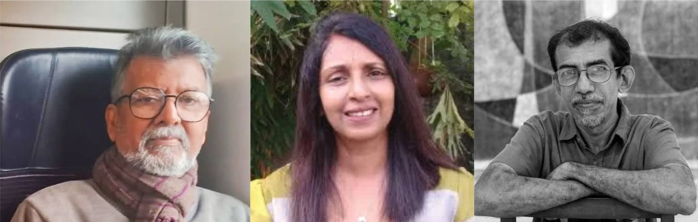

# Ruk Rakaganno Honours Three Distinguished Environmental Champions with Honorary Life Memberships

## Celebrating dedication, knowledge and a shared passion for protecting Sri Lanka’s natural heritage

The 51st Annual General Meeting of Ruk Rakaganno (The Tree Society of Sri Lanka), held on Saturday, 14 November 2026, was a particularly memorable occasion as the Society paid tribute to three distinguished individuals whose contributions have enriched its work and strengthened its commitment to protecting SriLanka’s natural environment.

In recognition of their outstanding contributions and longstanding association with the Society, Honorary Life Memberships were conferred on Professor Siril Wijesundera (left), Professor Mayuri Wijesinghe (middle)  and renowned artist Channa Ekanayake (right).

Each recipient has brought a unique blend of expertise, enthusiasm and commitment to Ruk Rakaganno, contributing in different ways to its environmental initiatives and public engagement.

## Recognising Excellence in Ecological Restoration

Professor Siril Wijesundera was honoured for his leadership of the Working Committee overseeing the Ecological Forest Restoration Project at Suduwalipotha, situatedwithin the buffer zone of the Sinharaja Rainforest.

Thisambitious restoration initiative has earned international recognition, winning the prestigious PATA Gold Award 2025 for Best Ecosystem and Wildlife Conservation Initiative. Selected from more than 100 international entries, this achievement represents a significant milestone for the project and reflects the importance of its contribution to ecosystem restoration and wildlife conservation.

Professor Wijesundera's guidance and leadership have been instrumental in advancing the project's objectives and strengthening its scientific and ecological foundations.

## Innovation and Research in Forest Restoration

Professor Mayuri Wijesinghe received Honorary Life Membership in recognition of her pioneering work in promoting scientific research and innovation in environmental conservation.

Among hernotable contributions is the introduction of the Smart Bee Box, the first of its kind in Sri Lanka, designed to monitor honeybee activity within a beehive in real time. This innovative initiative offers an exciting opportunityt o better understand honeybee behaviour and activity through technology.

Professor Wijesinghe also continues to undertake important research at the Suduwalipotha restoration site, studying the growth of wet-zone forest saplings under 28 different landscape conditions. This ongoing research is expected to contribute valuable scientific knowledge towards understanding the factors influencing the establishment and growth of native forest species in restored landscapes.

Her work exemplifies the important role that research, innovation and scientific knowledge play in achieving successful and sustainable forest restoration.

## Bringing People Closer to Nature Through Art

The third recipient, artist Channa Ekanayake, was recognised for his creativec ontribution to Ruk Rakaganno through the curation of numerous Tree Walks.

Thesewalks have provided participants with opportunities to discover, appreciate and better understand the remarkable diversity of trees and the natural environmentaround them.

Through his artistic eye and ability to interpret nature in engaging ways, Channa has helped make the Society's activities more accessible and enjoyable, bringingtogether people who share an appreciation of trees, nature and the environment.

His contribution highlights an important dimension of conservation: that protect ingnature is not solely about science and restoration, but also about inspiring people to connect with, appreciate and care for the natural world.

## A Shared Appreciation and a Lasting Association

The three recipients expressed their appreciation and delight at receiving the recognition, describing themselves as honoured and grateful to Ruk Rakaganno.

They also reflected warmly on their longstanding association with the Society and commended its unwavering commitment to environmental preservation over the years.

Special mention was made of the late Mrs. Kamini Vitarna, a former President of Ruk Rakaganno, whose contribution and dedication remain an important part of the Society's history and legacy.

The occasion was therefore not merely a presentation of honorary memberships, but also a celebration of the friendships, shared values and collective efforts that have helped sustain Ruk Rakaganno's environmental mission.

## New Leadership for the Year Ahead

The 51st AGM also saw several appointments to the Society's leadership and Executive Board for the ensuing year.

Dushy S.Perera was re-appointed as President, while Simon Lazenbet assumed the position of Vice President and David Grenier was appointed Honorary Treasurer.

Natashade Silva was appointed Honorary Secretary, with Professor Shiranee Balsuriyajoining the Executive Board as Mentor to the new Honorary Secretary.

These appointments will provide continuity while bringing renewed energy and guidance to the Society's work in the coming year.

## Continuing the Journey of Conservation

For more than five decades, Ruk Rakaganno has remained committed to protecting, conserving and restoring Sri Lanka's natural environment, with particularemphasis on its forests, trees and native biodiversity.

The recognition of Professor Siril Wijesundera, Professor Mayuri Wijesinghe andChanna Ekanayake is a reflection of the collaborative spirit that lies at theheart of this mission.

Their contributions demonstrate that meaningful conservation is achieved through a combination of scientific knowledge, research, innovation, creativity and public engagement.

As Ruk Rakaganno looks towards the future, the Society remains grateful to the many individuals who have contributed their time, expertise and passion to its journey.

The honorary memberships bestowed at the 51st AGM are more than an acknowledgement of past contributions. They are a celebration of a shared commitment to safe guarding Sri Lanka's natural heritage for generations to come.
